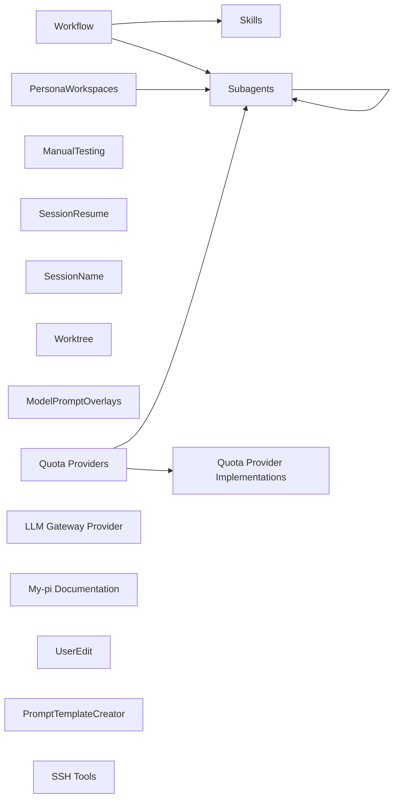
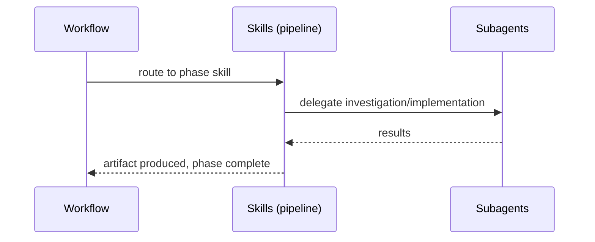

# Codemap

## Overview

A personal [pi coding agent](https://github.com/badlogic/pi-mono) package providing a development workflow pipeline (brainstorm → architect → test-write → test-review → impl-plan → implement → review → handle-review → manual-test → cleanup), standalone utility skills, a subagent orchestration system, the LLM Gateway provider, and quota attachment support. Built as a pi package with TypeScript extensions and Markdown skills.

### Key Flows

## Modules

### Workflow

The ten workflow skills and the autoflow orchestration skill that drives them. Autoflow is invoked via the `/skill:autoflow` skill command (or automatically on a new session's first message via the Autoflow Autostart extension); the skills define each phase's behavior and autonomous pipeline execution. A bundled transition-check script (`skills/autoflow/check-transition.ts`) validates phase artifacts between subagent handoffs.

**Responsibilities:** pipeline phase routing, artifact-driven handoffs, context boundary management, autonomous pipeline orchestration, autonomous phase transition validation, multi-repo workspace support (the workspace shape is proven once, and only a multi-repo run loads the disclosed hub contract that supplies per-repository baselines, commits, working directories, and the branch precondition), brainstorming facilitation, architectural decision-making (with high-fidelity, CSS-styled interactive HTML mocks for UI work that match existing UIs closely, listed in the plan's handoff manifest, consumed by downstream phases, and deleted at cleanup), test writing, test review, implementation planning, dual-mode implementation execution, plan-based code review, review finding resolution, human-style manual testing with a persistent smoke suite and feature map, post-workflow cleanup with DR extraction

**Dependencies:** Skills (decision-records skill delegated from cleanup; autoflow orchestrates the pipeline from brainstorm through cleanup), Subagents (workflow skills delegate to subagents at runtime — scout investigation in architecting/impl-planning, worker orchestration in implementing, parallel fan-out in code review, autonomous phase execution in autoflow)

**Files:**
- `skills/autoflow/SKILL.md`
- `skills/autoflow/HUB.md` — the multi-repo contract, disclosed behind a context pointer and read only when the workspace holds more than one repository
- `skills/autoflow/workspace.ts` — pure `## Workspace` row parsing plus base-commit and detached-`HEAD` reachability predicates over an injected Git probe
- `skills/autoflow/check-transition.ts`
- `skills/autoflow/check-transition.test.ts`
- `skills/autoflow/workspace.test.ts`
- `skills/brainstorming/SKILL.md`
- `skills/architecting/SKILL.md`
- `skills/test-writing/SKILL.md`
- `skills/test-review/SKILL.md`
- `skills/impl-planning/SKILL.md`
- `skills/implementing/SKILL.md`
- `skills/code-review/SKILL.md`
- `skills/handle-review/SKILL.md`
- `skills/manual-testing/SKILL.md`
- `skills/cleanup/SKILL.md`
- `docs/brainstorms/**`
- `docs/plans/**`
- `docs/reviews/**`
- `docs/manual-tests/**` — topic-specific manual-test reports, including persona-workspaces checks T1–T13/R1–R7/D1–D2 and their results
- `tools/manual-test/**` — permanent live-pi harnesses and journey plan: `persona-workspaces/run.mjs` (+ README) covers root takeover, spawned identity/override, binding, resume/reload, restore and fork; `model-tiers/run.mjs` is provider/model-parameterized with provider-agnostic prompt extraction and LLM Gateway plus DevPass quota-source support; the corrected persona-workspaces and model-tiers harnesses have deterministic helper tests beside them; `quota-providers/run.mjs` exercises provider-ID attachment, blocking, bypass, quota status, and usage-cache persistence with a deterministic local provider/source, plus an optional live Gateway probe; `resume-restore/README.md` documents `PI_CODING_AGENT_DIR` passthrough; `PLAN.md` includes journeys J8/J9 and updated J1/J2

### Skills

Standalone utility skills not tied to the workflow pipeline.

**Responsibilities:** codemap generation and maintenance, structured debugging, decision record management (format, numbering, supersession), skill authoring guidance (invocation axis, information hierarchy, pruning, leading words), domain language maintenance (glossary.md convention, active term-sharpening discipline), code design doctrine (deep modules/seams at module level, function-level principles in FUNCTIONS.md — referenced by the pipeline skills), periodic architecture review (user-invoked deepening scan with HTML report), tool prompt design (which field holds which fact: snippet for the planner, guidelines for cross-tool routing, description for the caller)

**Dependencies:** none

**Files:**
- `skills/codemap/SKILL.md`
- `skills/debugging/SKILL.md`
- `skills/decision-records/SKILL.md`
- `skills/skill-writing/SKILL.md`
- `skills/skill-writing/GLOSSARY.md`
- `skills/domain-modeling/SKILL.md`
- `skills/domain-modeling/FORMAT.md`
- `skills/codebase-design/SKILL.md`
- `skills/codebase-design/FUNCTIONS.md`
- `skills/codebase-design/DEEPENING.md`
- `skills/codebase-design/DESIGN-IT-TWICE.md`
- `skills/improve-code/SKILL.md`
- `skills/tool-design/SKILL.md`
- `skills/tool-design/SCHEMA-SUBSET.md` — the portable JSON Schema keyword subset that compiles across all major providers, per-provider transforms, and provider failure shapes; reached through a context pointer in SKILL.md
- `docs/decisions/**`

### Web Tools

Typed `web_search` and `web_fetch` tools replacing the former brave-search shell-script skill. Search: Brave adapter with result normalization (canonical URL dedupe, domain filters) and compact card output, backed by a TTL/LRU memory cache. Fetch: URL/redirect SSRF policy gate, bounded HTTP fetch with retries and `Retry-After` handling, Readability→Turndown extraction with a quality gate (cookie-wall/shell/title-only signals), disk-backed page cache under the pi agent dir (atomic writes, lazy TTL, mtime pruning), offset pagination, case-insensitive `findText` passage retrieval, and bounded-concurrency batch fetch (max 8 URLs). Fetched pages are stored in full on disk so continuation and passage search are cache hits across restarts. Research grounding in `docs/research/web-search-landscape.md`.

**Responsibilities:** web discovery (Brave), known-URL retrieval, main-content extraction, page caching, bounded context delivery (slice/offset/findText), URL/redirect policy enforcement, structured results (`outputSchema`/`structuredContent` over the normalized search response and per-URL fetch metadata including the page slice, so codemode scripts get data instead of cards)

**Dependencies:** Brave Search API (`BRAVE_API_KEY`), `@mozilla/readability`, `jsdom`, `turndown`, `turndown-plugin-gfm` (from the package root), `lib/truncate.ts`

**Dependencies:** Brave Search API (`BRAVE_API_KEY`), `@mozilla/readability`, `jsdom`, `turndown`, `turndown-plugin-gfm` (from the package root)

**Files:**
- `extensions/web-tools/**` — `index.ts` (tool registration), `web-search.ts`/`search/brave.ts`/`search/normalize.ts` (discovery), `web-fetch.ts`/`http.ts`/`extract.ts` (retrieval/extraction), `url-policy.ts` (SSRF/redirect policy), `fetch-store.ts` (disk page cache), `cache.ts` (search memory cache), `find-text.ts` (passage search), `types.ts` (canonical types), with colocated tests and HTML fixtures
- `docs/research/web-search-landscape.md`

### SSH Tools

Remote Bash and file tools that leave Pi's built-in tools local.

**Responsibilities:** direct open and deferred SSH helpers, session-scoped binding and shutdown, one OpenSSH connection with a persistent Bash shell and separate file channels, fixed remote file paths, core tool adapters

**Dependencies:** Pi's tool definitions and pluggable operations, Unix OpenSSH, remote Bash

**Files:**
- `extensions/ssh-tools/**`: tool adapter, session owner, transport, and contract tests
- `tools/manual-test/ssh-tools/**`: isolated OpenSSH test runner

### Subagents

Long-lived in-process subagent orchestration extension — creates and manages SDK child sessions with channel-based messaging and incremental membership. Each child owns an SDK-created `ModelRuntime`, backed by the common persisted Pi configuration rather than a parent in-memory auth or model registry. Includes agent definitions and skills for using/creating agents.

**Responsibilities:**

- Own the root registry and one manager per child scope. Each manager controls its immediate children and their channels.
- Create and resume isolated child runtimes. Persist each child's session and lifecycle under its parent.
- Resolve the active persona, its tool and skill policy, and its model before binding the child. See [Extensions](docs/extensions.md) for configuration and precedence.
- Route messages locally and reject wait cycles. Record child results by incarnation and deliver them through an await or notice.
- Persist explicit user holds. Sessions and results do not depend on whether a Pimote view is open.
- Expose the hierarchy, guarded controls, borrowed child-session leases, and pure presenters through one Pimote provider per root.
- Render the TUI dashboard and report live work to Pimote's idle-reap guard.

**Dependencies:** Persona Workspaces (imports its pure `declaration.ts` persona parser for spawn-time active-persona selection; a one-way code dependency — see that module for the reciprocal registry dependency); Pimote SDK (registers the root-scoped subagent provider)

**Files:**
- `extensions/subagents/session-owner.ts`, `extensions/subagents/agent-set.ts`, and `extensions/subagents/managed-child-session.ts`: tool bindings, manager operations, and child runtime ownership.
- `extensions/subagents/agent-session-registry.ts`, `extensions/subagents/control-port.ts`, `extensions/subagents/persistence.ts`, and `extensions/subagents/session-snapshot.ts`: tree identity, guarded mutations, lifecycle records, and restore.
- `extensions/subagents/settlements.ts`, `extensions/subagents/settlement-receipts.ts`, and `extensions/subagents/turn-coordinator.ts`: waits and result delivery. Receipts verify the parent branch's model-facing text. Direct removal retains uncommitted answers.
- `extensions/subagents/notification-queue.ts` and `extensions/subagents/message-router.ts`: parent notices and agent messaging.
- `extensions/subagents/provider.ts`, `extensions/subagents/presenters.ts`, `extensions/subagents/presenters-legacy.ts`, and `extensions/subagents/tool-progress.ts`: SDK integration and card data from native Pi events and sessions.
- `extensions/subagents/tool-results.ts`, `extensions/subagents/child-tool-policy.ts`, and `extensions/subagents/child-session-marker.ts`: model-facing results, tool policy, and persona binding.
- `extensions/subagents/activity.ts`, `extensions/subagents/status-display.ts`, and `extensions/subagents/model-tiers.ts`: idle reap, TUI status, and model selection.
- `vitest.config.ts` (repo root — test runner config)
- `skills/orchestrating-agents/SKILL.md`
- `skills/orchestrating-agents/PATTERNS.md`
- `skills/orchestrating-agents/COORDINATION.md`
- `skills/orchestrating-agents/MODEL-SELECTION.md`
- `skills/orchestrating-agents/ADVANCED.md`
- `skills/specialist-design/SKILL.md`
- `agents/scout.md`
- `agents/comment-sicko.md`
- `agents/spaghetti-sicko.md`
- `agents/test-sicko.md`
- `agents/documentation-sicko.md`

### Persona Workspaces

Extension that lets a persona file take over a session — a *persona file* is either a discovered agent definition or a working directory's `AGENTS.md` with `kind: persona` front matter. The persona IS the personality: the body displaces pi's default identity at the head of the prompt and never stacks under it by choice — stacking is only the self-healing fallback on an unpatched host. Persona presence is orthogonal to root-vs-subagent: all four root/child × persona/plain combinations are valid.

**Responsibilities:** strict cwd-only workspace persona declaration parsing (`<cwd>/AGENTS.md` exactly — one directory deep, no ancestor walk; unknown `kind` values silently ignored and a non-persona file left entirely alone as project context), per-run prompt binding (`before_agent_start`; the active persona's body binds as `sections.preamble` — pi's first slot — every run, so pi's own tool declarations, rules, docs, project context, and skills stay untouched below it in default order; mid-session edits take effect at the next run and record as a small preamble-only delta; an explicit launch `--system-prompt` outranks the ambient persona and touches nothing; the workspace's own AGENTS.md is filtered from `contextFiles` so pi cannot append it twice — ancestor AGENTS.md files and `AGENTS.<model>.md` overlays are untouched; a declared `skills` list filters the per-run skills view, while root sessions keep unlisted skills' slash commands loaded — extensions can add skills at discovery but not subtract), session-start front-matter binding (`session_start`; root `model`/`tools` rebind at every boundary, including resume/reload/fork, via `pi.setModel`/`pi.setActiveTools` with child-side `resolveChildToolPolicy` normalization; child construction is owned by Subagents), and the child-side transcript-visible `customType: "persona-notice"` override message with a registered pi-tui renderer and transcript-based deduplication (the only notice — persona takeovers are silent by design, with `/sysprompt`'s projection as the pre-run visibility surface). Persona sources are exclusive: a workspace declaration wins wholesale over a spawned definition — one active persona file per session, fields never merged, absent fields fall to defaults/baseline.

**Dependencies:** Subagents (reads spawn-declared persona payload from `child-session-marker.ts` via `ctx.sessionManager`; Subagents also imports this module's pure `declaration.ts` parser to resolve active child construction fields).

**Prompt composition:** every prompt contribution in the package goes through the structured prompt options (`sections`) — Subagents contributes a `subagents` section and Model Prompt Overlays a `model-overlays` section, and nothing returns a forced `systemPrompt` — so extension load order carries no correctness weight.

**Deployment (self-healing host patch):** unpatched pi throws on a section named `preamble`, so `host-patch.ts` rewrites the host's unbundled prompt module and, for the standard CLI, its minified `dist/bundle/chunks` prompt builder at extension activation — three exact-string touches (validation guard, `customSections.preamble ??` override under the `customPrompt`-unset branch, merge-loop precedence), atomic, idempotent, once per runtime directory. The running process keeps its in-memory module: the override tier activates from the next session start, and the extension notifies once. Until then — the first session after a pi/pimote update, or an incompatible runtime — the persona stacks as a plain `<persona>` custom section on top of pi's preamble. The transform is all-or-nothing with per-snippet verification, so an incompatible pi never gets a partial write.

**Files:**
- `extensions/persona-workspaces/**` — `declaration.ts` (pure `kind: persona` front-matter parsing + strict cwd loader), `host-patch.ts` (self-healing host runtime patch enabling `sections.preamble`: pure exact-string transform + atomic file application), `index.ts` (the `session_start` and `before_agent_start` handlers, tier selection, and the `persona-notice` renderer), `package.json` (pi extension manifest), with colocated tests

### Session Name

Extension that provides a `set_session_name` LLM tool — lets the model name (or clear) the current session's display name, the same `session_info` mechanism behind `/name` and the session-selector rename. The name shows in session lists and resume pickers. Each session names itself: a subagent's call names its own child session (overriding its agent-path-derived name), never the parent's.

**Responsibilities:** set_session_name tool registration, old-name precondition to prevent stale model updates from clobbering manual renames (mismatch fails without revealing the current name), name normalization (line breaks to spaces, trim, empty clears), length validation (200 chars after normalization), unchanged-name no-op to keep session files free of redundant `session_info` entries. Result carries `details` ({name, previous}); the seam exemplar.

**Dependencies:** none (standalone extension loaded by pi)

**Files:**
- `extensions/session-name/**`

### Autoflow Autostart

Extension that opt-in triggers the autoflow pipeline at the start of a new session: the session's first user message is rewritten to an autoflow invocation with that message appended (`/skill:autoflow <message>` by default), so it enters the pipeline exactly as if the user had invoked it in one send.

**Responsibilities:** opt-in config loading (`~/.pi/agent/autoflow.json` — `autoStart` flag plus a configurable invocation `command`; a missing or malformed file degrades to opt-out with a one-time warning), new-session trigger arming (fresh root sessions only — resumes, forks, and subagent child sessions never autostart), first-message rewrite via the `input` event (other slash commands and `!`/`!!` bash pass through and stay armed; a manual autoflow invocation or input queued during streaming consumes the trigger)

**Dependencies:** Subagents (queries `child-session-marker.ts` to stay silent inside subagent child sessions, which load this extension too)

**Files:**
- `extensions/autoflow-autostart/**` — `index.ts` (pi wiring), `config.ts` (pure config parsing + agent-dir loading), `trigger.ts` (pure arming and rewrite decisions), with colocated tests

### Worktree

Extension that manages git worktree–based branch sessions — create a worktree, optionally transfer working changes and session context, resume an existing worktree, or clean up by merging back and removing the worktree.

**Responsibilities:** worktree lifecycle (create, resume, cleanup), branch creation via `git worktree add`, stash-based change transfer between worktrees, merge orchestration (delegates to agent via `sendUserMessage`), cross-cwd session transitions (fork/create/continue), interactive prompts for context transfer and pending-changes policy, `/worktree` command argument parsing and branch-name autocomplete

**Dependencies:** none (standalone extension; uses pi core extension APIs and git CLI at runtime)

**Files:**
- `extensions/worktree/**`

### LLM Gateway Provider

Normal pi provider extension for the LLM Gateway DevPass service. It registers
provider ID `llmgateway`, uses the OpenAI Completions API, authenticates with
`LLMGATEWAY_API_KEY`, and refreshes the `/v1/models` catalog through pi's
provider-cache contract. Pi supplies the OpenAI Completions streaming
implementation. This extension owns model metadata, not quota policy.

**Responsibilities:** provider registration, catalog refresh and one-hour
stored-catalog reuse, offline catalog restore, model metadata conversion, and
LLM Gateway authentication

**Dependencies:** pi's provider registration and model-cache seams, LLM Gateway
`/v1/models`, `LLMGATEWAY_API_KEY`

**Files:**
- `extensions/llm-gateway/**`

### Quota Providers

Quota-only extension. Configuration names existing pi provider IDs and loads a
quota-source module for each attachment through jiti. The core polls usage,
stores snapshots and model-limit membership, tracks local ledger spend, and
applies quota decisions at the provider stream boundary. It does not discover
models, manage provider tokens, register providers, or rewrite retry errors.

**Responsibilities:** attachment parsing and policy defaults, usage polling and
atomic cache writes, ledger pruning and spend tracking, soft-cap and opt-in
hard-cap enforcement, tree-scoped bypass, `/quota` command, and footer/status
indicator

**Dependencies:** Subagents' tree-scoped key/value store, jiti for quota-source
loading, and pi's complete-provider registration seam

**Files:**
- `extensions/quota-providers/**`
- `lib/session-tree-store.ts` — shared interface for tree-scoped extension state
- `lib/tool-args.ts` — shared schema-driven normalizer (`dropEmptyOptionals`, `registerLooseTool`): treats empty optional tool parameters (`""`, `[]`, `false` for booleans) as omission via the `prepareArguments` hook

### Quota Provider Implementations

Built-in quota-source modules loaded by the Quota Providers extension. The
DevPass source reads LLM Gateway usage and catalog data for an `llmgateway`
attachment. It reports the monthly window from `billingCycleAnchor` and an
independent `premium-weekly` limit when the account provides one.

**Responsibilities:** provider-specific usage requests, billing-window
interpretation, and model-to-limit membership mapping

**Dependencies:** Quota Providers (typed source seam), LLM Gateway usage and
catalog endpoints, `LLMGATEWAY_API_KEY`

**Files:**
- `extensions/quota-providers/impls/devpass-quota.ts`

### Shared Tool Seam

Model-facing result/truncation helpers shared by every local tool.

**Responsibilities:** `truncateMiddle`/`truncateForModel` mirroring pi's unexported MCP-bridge behavior (20 KiB middle truncation around the `…N chars truncated…` marker, full text to a temp file named in the result, graceful degradation when the save fails); the seam contract itself is DR-060

**Dependencies:** `@earendil-works/pi-coding-agent` (`withFileMutationQueue`)

**Files:**
- `lib/truncate.ts`
- `lib/truncate.test.ts`

### Ask User

Extension providing the root-session `ask_user` LLM tool and reusable `showAskUser` TUI helper — a keyboard-driven single-choice dialog with inline annotation support; child sessions are prevented from invoking it by Subagents' normalized SDK tool policy.

**Responsibilities:** ask_user tool registration for root sessions, interactive option-list TUI component, selection and annotation flow, result `details` ({label, index, annotation} or {cancelled}) for rendering; no `outputSchema` — model-only exposure means codemode scripts can never call it

**Dependencies:** Subagents (child tool policy excludes `ask_user`; root sessions register it normally)

**Files:**
- `extensions/ask-user/**`
- `lib/components/ask-user.ts`

### User Edit

Extension that provides a `user_edit` LLM tool — opens a file in pi's built-in editor UI so the user can manually edit it. On save, the file is written to disk. Supports new file creation (opens empty, creates on save including parent dirs).

**Responsibilities:** user_edit tool registration, editor UI integration, file read/write with mutation queue, new-file creation with parent directory creation, result `details` ({path, saved}); no `outputSchema` — model-only exposure means codemode scripts can never call it

**Dependencies:** none (standalone extension loaded by pi)

**Files:**
- `extensions/user-edit/**`

### Prompt Template Creator

Extension that creates project-local Pi prompt templates through the built-in editor.

**Responsibilities:** `/nprompt <name>` command registration, safe project `.pi/prompts/<name>.md` path resolution, compact prompt-template learning scaffold, existing-template prefill, cancellation-safe writes, reload guidance

**Dependencies:** none beyond Pi's extension command, editor, and file-mutation APIs

**Files:**
- `extensions/new-prompt/**`

### Model Prompt Overlays

Extension that discovers AGENTS.*.md overlay files, matches them against the active model ID via glob patterns, and contributes matching content to the system prompt as a `model-overlays` section (structured options mutation, not a forced-prompt append).

**Responsibilities:** context root discovery (global agent dir + ancestor walk, mirroring pi's AGENTS.md resolution), overlay file loading and frontmatter validation (models field), glob-based model ID matching with specificity ranking, deterministic sort order (root order → broad-to-narrow specificity → path), overlay block rendered into a `model-overlays` section, per-session deduplicated diagnostic notifications

**Dependencies:** none (standalone extension; hooks `before_agent_start`)

**Files:**
- `extensions/model-prompt-overlays/**`

### My-pi Documentation

Canonical extension and configuration reference, including LLM Gateway provider setup, quota attachment configuration, and provider-ID migration; a prompt pointer makes the reference discoverable to agents.

**Responsibilities:** maintain the canonical extension/configuration reference; inject its absolute path into a small `before_agent_start` system-prompt section without copying the full document into every turn

**Dependencies:** none beyond pi's extension API

**Files:**
- `docs/extensions.md`
- `extensions/my-pi-docs/index.ts`
- `extensions/my-pi-docs/index.test.ts`

### Prompts

Slash-command prompts distributed with the package.

**Responsibilities:** `goal` pursues a user-stated outcome by inferring an evidence-backed operating contract, asking only blocking questions, and iterating until complete or blocked; `tidy` runs repo tidying; `resolve-conflicts` works an in-progress merge/rebase conflict by intent; `experiment` runs a goal-driven experiment campaign (candidate queue, single-variable A/B trials with baseline and keep-or-revert, living experiment log); `sickos` runs Comment, Spaghetti, and Test Sicko reviews concurrently with an optional shared scope override; `feature` guides feature work from problem exploration through cleanup.

**Dependencies:** none.

**Files:**
- `prompts/feature.md`
- `prompts/goal.md`
- `prompts/tidy.md`
- `prompts/resolve-conflicts.md`
- `prompts/experiment.md`
- `prompts/sickos.md`

### Conventions

Repo working rules for this package (`docs/conventions.md`): codebase rules that hold when working in `my-pi` — skill format, raw-TS extensions, strict type checking, agent definition format, and subagents as a local extension. The local Pimote SDK loop uses `npm link` without changing the registry dependency or lockfile. Cross-repo rules (dependency changes, git hooks, tone, initiative) live in `~/.pi/agent/AGENTS.md` and are not repeated here.

**Dependencies:** none.

**Files:**
- `docs/conventions.md`
- `docs/local-pimote-sdk.md`
- `scripts/link-pimote-sdk.mjs`
- `package.json`
